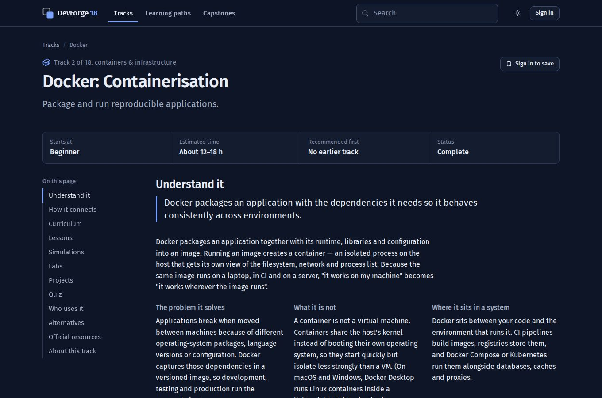
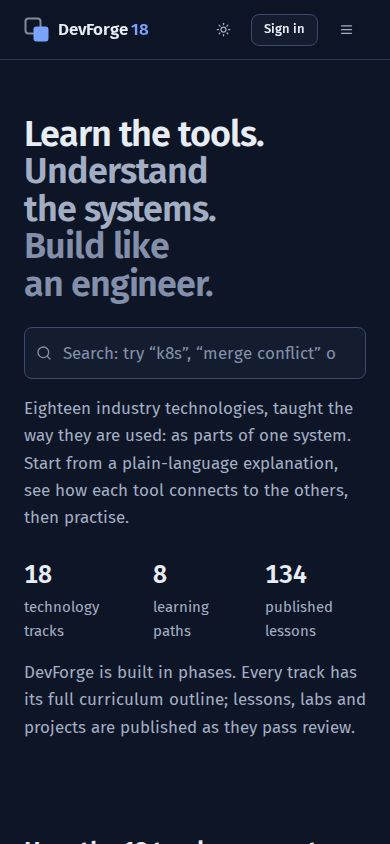
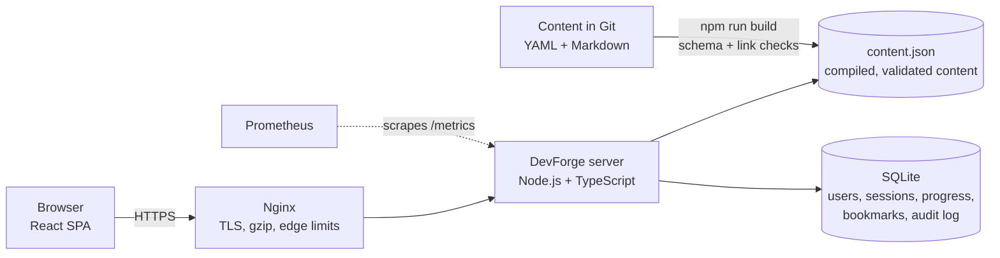

# DevForge 18

**Learn the tools. Understand the systems. Build like an engineer.**

DevForge 18 is an interactive developer engineering academy. It teaches 18 industry technology tracks — from Git and Docker to Kafka, OpenTelemetry and MLflow — the way they are actually used: as parts of one system. Every track starts with a plain-language explanation, shows where the tool sits in an architecture and how it connects to the others, and leads into lessons with graded self-checks, labs and projects.

> **Project status: Phase 1 in progress.** The platform, all 18 track curricula and 8 learning paths are in place, and 45 beginner lessons are published across all 18 tracks (Learning Paths 1 and 2 — Git, PostgreSQL, Postman, Redis, Nginx, Docker, GitHub Actions, Jenkins, Terraform, Kubernetes, Prometheus + Grafana, OpenTelemetry — plus Kafka, Airflow, MLflow, LangChain + LlamaIndex, n8n and Jira). Every command in every published lesson is run by the test suite against the real tool, and CI confirms the output matches; the two Jira lessons about the hosted Jira service are checked against Atlassian's documentation instead, and say so. Labs and projects are still being written; the app labels everything that is planned rather than available. See [`IMPLEMENTATION_STATUS.md`](IMPLEMENTATION_STATUS.md) for exactly what works today.


| Track page | Lesson reader | Mobile |
|---|---|---|
|  |  |  |

## Contents

- [What you can do today](#what-you-can-do-today)
- [The 18 tracks](#the-18-tracks)
- [Quick start](#quick-start)
- [Configuration](#configuration)
- [Project structure](#project-structure)
- [Architecture](#architecture)
- [Testing](#testing)
- [Writing content](#writing-content)
- [Deployment](#deployment)
- [Security](#security)
- [Documentation index](#documentation-index)
- [Known limitations](#known-limitations)
- [Licence](#licence)

## What you can do today

| Feature | Status |
|---|---|
| Browse all 18 tracks: explanation, problem solved, what it is *not*, architecture position, curriculum by level, labs, projects, official resources | Working |
| Interactive system map showing how the tracks connect, with an explanation behind every connection | Working |
| 8 learning paths with ordered modules, prerequisites, alternate routes and time estimates | Working |
| Search across tracks, curriculum topics, lessons and paths, with typo tolerance and abbreviations (`k8s`, `pg`, `otel`) | Working |
| Lesson reader with objectives, table of contents, copyable code blocks, expected output and a server-graded self-check | Working (45 lessons; their commands are run by the test suite and in CI) |
| Figures in every lesson, and step-through diagrams (Previous/Next, arrow keys, Play) for processes in every track with lessons; both themes, reduced motion respected | Working (46 figures, 18 of them step-throughs) |
| Interactive simulations with challenges, verified by the server and saved to progress: Git commit graph, Kubernetes reconciliation loop, Prometheus scrape and rate, OpenTelemetry trace waterfall, Kafka consumer groups, Airflow scheduler timeline, MLflow experiment explorer, a RAG pipeline, an n8n workflow executor, a Jira sprint board | Working (10 of the planned 18) |
| Accounts, sign-in, progress tracking (a lesson completes only when its self-check is passed), bookmarks, dashboard | Working |
| Roles (student, faculty, admin), admin user management with an audit log, faculty aggregate statistics | API working; admin/faculty screens not built yet |
| Dark and light themes, keyboard navigation, mobile layout | Working |
| Labs, simulations for the other 16 tracks, capstone projects, quizzes, architecture studio, case studies, cohorts | Planned (see roadmap) |

## The 18 tracks

| # | Track | Technologies |
|---|---|---|
| 1 | Version Control & Collaboration | Git, GitHub |
| 2 | Containerisation | Docker |
| 3 | Container Orchestration | Kubernetes |
| 4 | Relational Databases | PostgreSQL |
| 5 | Infrastructure as Code | Terraform |
| 6 | CI/CD | GitHub Actions |
| 7 | Monitoring & Metrics | Prometheus, Grafana |
| 8 | LLM Application Frameworks | LangChain, LlamaIndex |
| 9 | Caching & Fast Data | Redis |
| 10 | Event Streaming | Apache Kafka |
| 11 | CI/CD Automation | Jenkins |
| 12 | Agile Project Management | Jira |
| 13 | API Development & Testing | Postman |
| 14 | Web Traffic & Reverse Proxy | Nginx |
| 15 | Observability | OpenTelemetry |
| 16 | Workflow Orchestration | Apache Airflow |
| 17 | Workflow & AI Automation | n8n |
| 18 | MLOps & Experiment Tracking | MLflow |

## Quick start

**Requirements:** [Node.js](https://nodejs.org/) **22.18 or newer** (22 LTS or 24). Nothing else — no database server to install. Check with `node --version`.

```bash
git clone <your-repository-url> devforge18
cd devforge18
npm install
npm run build      # validates all content, then bundles the frontend
npm start          # http://localhost:8080
```

The SQLite database is created automatically at `./data/devforge.db` on first start.

**Create the first administrator** (DevForge never ships default accounts):

```bash
npm run user:create -- --email you@college.edu --name "Your Name" --role admin
```

You will be prompted for a password (at least 10 characters). Students create their own accounts on the website; self-registration always creates a *student* account.

**During development**, rebuild the frontend after editing files in `web/`, or use:

```bash
npm run dev        # builds once, then restarts the server when server/ files change
WEB_DEV=1 npm run web:build   # readable bundle with source maps
```

### Common setup problems

| Symptom | Cause and fix |
|---|---|
| `SyntaxError` mentioning a type annotation, or `ERR_UNKNOWN_FILE_EXTENSION ".ts"` | Node is older than 22.18, so it cannot run TypeScript directly. Upgrade Node. |
| `Content bundle not found at ./build/content.json` | Run `npm run build` before `npm start`. |
| `EADDRINUSE` | Port 8080 is taken. Run with `PORT=8090 PUBLIC_ORIGIN=http://localhost:8090 npm start`. |
| Every sign-in fails with "Request blocked by cross-site request protection" | `PUBLIC_ORIGIN` does not match the address in your browser bar (for example `localhost` vs `127.0.0.1`). Make them identical. |
| `ExperimentalWarning: SQLite` | Harmless; `node:sqlite` is still flagged experimental. The npm scripts hide it. |

## Configuration

All configuration is through environment variables, validated at start-up. Every variable is documented in [`.env.example`](.env.example). To use a file:

```bash
cp .env.example .env
node --env-file=.env --disable-warning=ExperimentalWarning server/src/main.ts
```

The most important ones:

| Variable | Default | Purpose |
|---|---|---|
| `PORT` / `HOST` | `8080` / `127.0.0.1` | Where the server listens |
| `PUBLIC_ORIGIN` | `http://localhost:8080` | The exact origin users' browsers use; checked on every state-changing request |
| `DATABASE_PATH` | `./data/devforge.db` | SQLite file location |
| `COOKIE_SECURE` | `true` in production | Must be `true` whenever the site is served over HTTPS |
| `TRUST_PROXY` | `false` | Set `true` only behind a trusted reverse proxy such as the bundled Nginx |

## Project structure

```text
content/              Learning content (YAML + Markdown) — reviewed like code
  tracks/<slug>/track.yaml   one file per track (18)
  paths/<slug>.yaml          learning paths (8)
  lessons/<track>/<id>.md    lessons with front matter and self-check questions
  media/<track>/             SVG figures (+ .yaml sidecars) and step-throughs
  simulations/<track>/       simulation scenarios and challenges
shared/               Code used by both server and browser
  content-schema.ts          zod schemas: the single definition of valid content
  simulations/               pure simulation models (browser and server)
  search.ts                  search engine (synonyms, prefix, typo tolerance)
server/
  src/                Node.js HTTP API (TypeScript, run directly by Node 22)
    auth/  db/  http/  routes/  content/  observability/
  test/               API integration and unit tests (node:test)
web/
  src/                React frontend: pages/, components/, lib/, styles/
  public/             fonts (Fira Sans, SIL OFL), favicon, theme bootstrap
scripts/              content build, web build, migrations, backups, link checks
e2e/                  browser tests (Playwright + node:test)
deploy/               Dockerfile, Docker Compose and Nginx configuration
docs/                 architecture, decisions (ADRs), security, deployment, content guide
```

## Architecture



- **Content is code.** Tracks, paths and lessons are files in Git, validated against strict schemas at build time and compiled into one JSON bundle. Invalid content cannot be published, and every change is reviewable in a pull request.
- **The server** is a small, dependency-light Node.js application: a typed router on `node:http`, SQLite through Node's built-in `node:sqlite`, and zod for input validation. It is the only runtime dependency.
- **The frontend** is a React single-page app bundled with esbuild. Lesson HTML is rendered at build time, so no Markdown parser ships to browsers.
- **Observability**: structured JSON logs with request IDs and a Prometheus `/metrics` endpoint (restricted to private networks).

Details and the reasoning behind each choice: [`docs/architecture.md`](docs/architecture.md) and the decision records in [`docs/adr/`](docs/adr/).

## Testing

```bash
npm run typecheck       # strict TypeScript: server, shared code, scripts, tests
npm run typecheck:web   # strict TypeScript: React frontend
npm test                # unit, API, checker and executable-lesson tests
npm run test:e2e        # 32 browser journeys in headless Chromium (builds first)
npm run verify          # everything above, in order
```

End-to-end tests need a browser once: `npx playwright install chromium`.

What the tests cover: content validation (including deliberately broken content), Markdown XSS protection, search quality, authentication and session security, CSRF protection, brute-force limits, role-based access, server-side lesson grading, progress and bookmarks, migrations, path-traversal attempts, and full browser journeys — registration through lesson completion, the system map, search, theming, keyboard access and mobile layout. Browser tests fail on *any* console error, which includes Content-Security-Policy violations. See [`docs/testing.md`](docs/testing.md).

## Writing content

Everything a learner reads lives in `content/`. To add a lesson, create `content/lessons/<track>/<lesson-id>.md` with front matter (objectives, self-check questions with explanations, resources, review date) and run `npm run build`. The build rejects invalid content with a precise message such as:

```text
error tracks/redis/track.yaml: entry_level — Invalid enum value. Expected 'beginner' | 'intermediate' | 'advanced', received 'expert'
```

Read [`docs/content-authoring.md`](docs/content-authoring.md) before writing: it defines the quality bar, the accuracy rules (never invent resources, videos or company claims) and how link verification works.

## Deployment

```bash
cd deploy
docker compose up --build     # Nginx on http://localhost:8080 in front of the app
```

For a real server (HTTPS, backups, upgrades, monitoring) follow [`docs/deployment.md`](docs/deployment.md). Back up the database at any time, even while running:

```bash
npm run db:backup             # writes ./backups/devforge-<timestamp>.db and verifies it
```

## Security

Highlights: scrypt password hashing at OWASP-recommended cost, hashed server-side session tokens in `HttpOnly; SameSite=Lax` cookies, CSRF protection, a strict Content-Security-Policy without `unsafe-inline`, per-account brute-force protection designed for classrooms sharing one IP address, server-side validation of every input, an audit log for administrative actions, and no execution of learner code on the server. Full model and checklist: [`docs/security.md`](docs/security.md).

Found a vulnerability? Please report it privately to the maintainers rather than opening a public issue.

## Documentation index

| Document | Read it when |
|---|---|
| [`IMPLEMENTATION_STATUS.md`](IMPLEMENTATION_STATUS.md) | You want to know exactly what is finished, tested, pending or known to be broken |
| [`REMAINING_WORK.md`](REMAINING_WORK.md) | You want the plan for everything still to build: simulations for all 18 tracks, pictures and animations, labs, projects, case studies, alternatives |
| [`MASTER_PROMPT.md`](MASTER_PROMPT.md) | You want to continue the project with a coding agent |
| [`docs/architecture.md`](docs/architecture.md) | You want to understand how the platform works |
| [`docs/adr/`](docs/adr/) | You want to know *why* a technical decision was made |
| [`docs/content-authoring.md`](docs/content-authoring.md) | You are writing or reviewing learning content |
| [`docs/design-system.md`](docs/design-system.md) | You are changing the UI |
| [`docs/security.md`](docs/security.md) | You are deploying, reviewing or changing anything security-relevant |
| [`docs/deployment.md`](docs/deployment.md) | You are running DevForge for real users |
| [`docs/testing.md`](docs/testing.md) | You are adding or debugging tests |
| [`CONTRIBUTING.md`](CONTRIBUTING.md) | You want to contribute |

## Known limitations

- 45 lessons are published across all 18 tracks; nine of them have two lessons, and eight of those no simulation yet (milestone 5 continues). Labs and projects are listed as planned.
- External resource links were all checked and reviewed on 2026-11-25. The weekly *Link check* workflow reports reachability; a person re-confirms each page before its date is updated.
- Admin and faculty features exist in the API but have no screens yet.
- Rate limits are kept in memory, so they apply per server process. See [ADR 0004](docs/adr/0004-auth-sessions.md).
- The full list, with workarounds, is in [`IMPLEMENTATION_STATUS.md`](IMPLEMENTATION_STATUS.md#known-issues-and-limitations).

## Licence

No licence has been chosen yet, so all rights are reserved by default. Before publishing, choose a licence for the code (for example MIT or Apache-2.0) and, separately, for the learning content (for example CC BY-SA 4.0), and add the `LICENSE` file(s).

The bundled Fira Sans font is licensed under the SIL Open Font License 1.1 (`web/public/fonts/OFL.txt`). Product names are trademarks of their respective owners and are used only to identify the technologies taught; no endorsement is implied.
