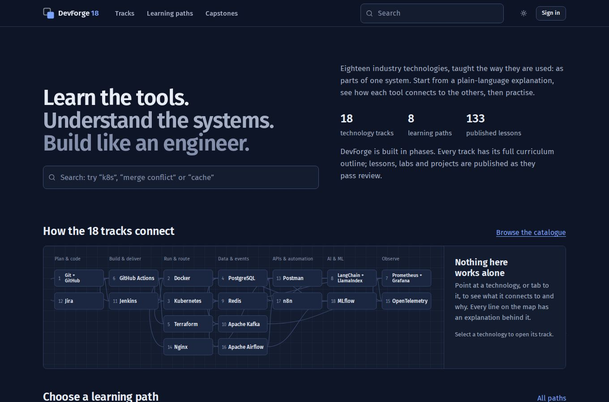
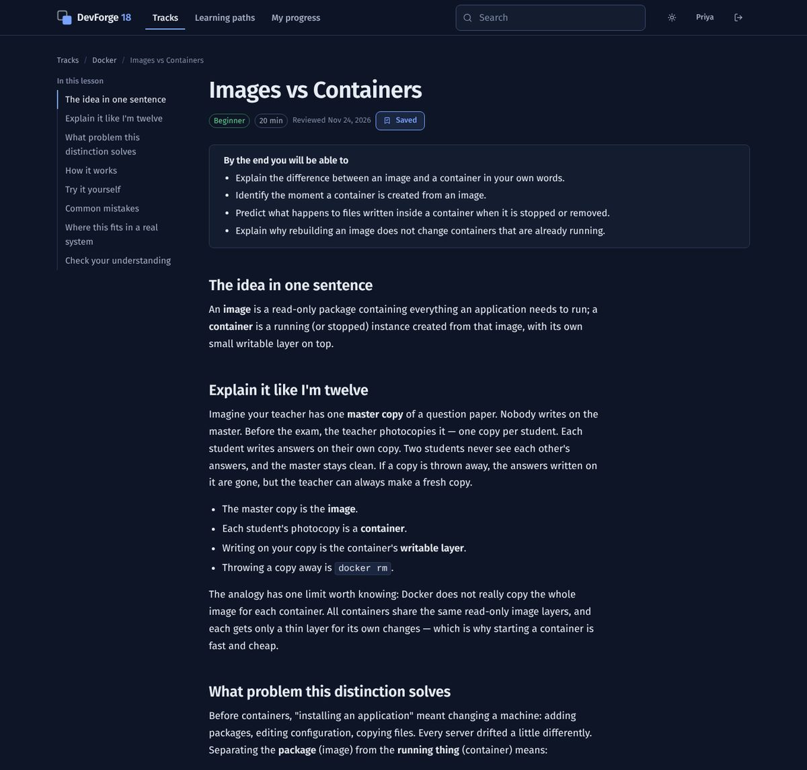
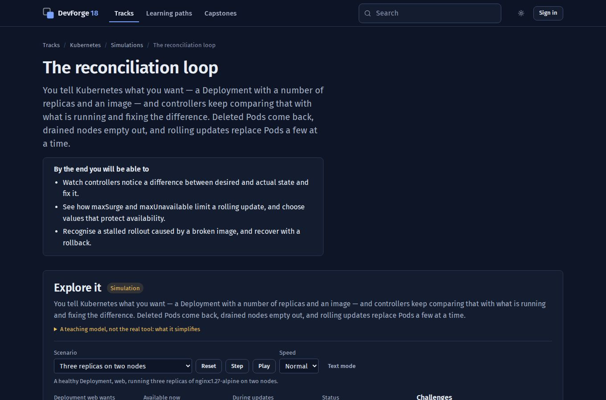
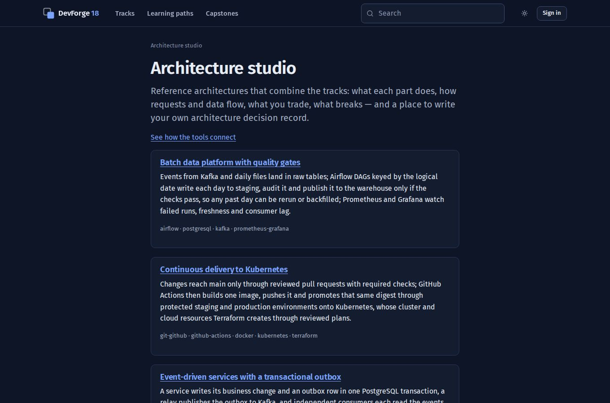
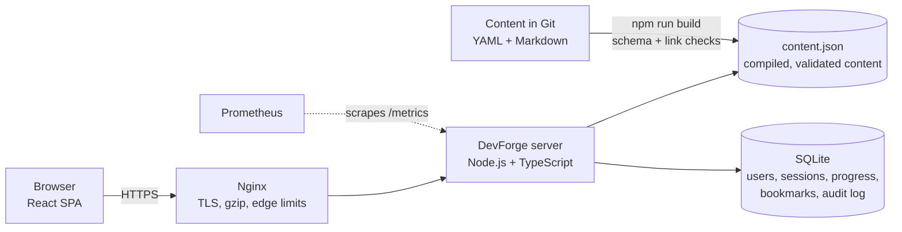

# DevForge 18

**Learn the tools. Understand the systems. Build like an engineer.**

DevForge 18 is an interactive developer engineering academy. It teaches 18 industry technology tracks — from Git and Docker to Kafka, OpenTelemetry and MLflow — the way they are actually used: as parts of one system. Every track starts with a plain-language explanation, shows where the tool sits in an architecture and how it connects to the others, and leads into lessons with graded self-checks, labs and projects.

> **Project status: v1.0.** All 18 tracks are complete: 133 lessons (beginner to advanced), 18 simulations, 37 labs, 18 quizzes, 54 mini-projects, 7 capstones, 17 integrations between tracks and 10 reference architectures, plus cohorts, reviews, portfolios and certificates for colleges. Every command in 131 of the 133 lessons is run by the test suite against the real tool and CI confirms the output; the two lessons about the hosted Jira service are checked against Atlassian's documentation instead, and say so. Simulations are labelled as simulations. See [`IMPLEMENTATION_STATUS.md`](IMPLEMENTATION_STATUS.md) for the evidence and [`CHANGELOG.md`](CHANGELOG.md) for the release notes.



| Track page | Lesson reader | Mobile |
|---|---|---|
|  |  |  |

| Simulation (labelled as one) | Architecture studio |
|---|---|
|  |  |

Screenshots are regenerated from the built app with `node --disable-warning=ExperimentalWarning scripts/readme-screenshots.ts` (last run 2026-11-28).

## Contents

- [What you can do today](#what-you-can-do-today)
- [The 18 tracks](#the-18-tracks)
- [Quick start](#quick-start)
- [Configuration](#configuration)
- [Project structure](#project-structure)
- [Architecture](#architecture)
- [Testing](#testing)
- [Writing content](#writing-content)
- [Deployment](#deployment)
- [Security](#security)
- [Documentation index](#documentation-index)
- [Known limitations](#known-limitations)
- [Licence](#licence)

## What you can do today

| Feature | Status |
|---|---|
| Browse all 18 tracks: explanation, problem solved, what it is *not*, architecture position, curriculum by level, labs, projects, official resources | Working |
| Interactive system map showing how the tracks connect, with an explanation behind every connection; a relationship graph and 17 integration pages (how two tools work together, with practice items) | Working |
| 8 learning paths with ordered modules, prerequisites, alternate routes and time estimates | Working |
| Search across tracks, curriculum topics, lessons and paths, with typo tolerance and abbreviations (`k8s`, `pg`, `otel`) | Working |
| Lesson reader with objectives, table of contents, copyable code blocks, expected output and a server-graded self-check | Working (133 lessons: 54 beginner, 42 intermediate, 37 advanced; 131 executed in CI, 2 Jira lessons checked against documentation) |
| Figures in every lesson, and step-through diagrams (Previous/Next, arrow keys, Play); both themes, reduced motion respected | Working (134 figures in 133 lessons, 22 lessons with step-throughs) |
| Interactive simulations with challenges, verified by the server and saved to progress, one per track, each labelled as a simulation and saying what it simplifies | Working (18) |
| Labs: local labs with a check script, simulation labs with server-verified challenges, and a read-through lab graded on the server; progress records whether completion was checked or self-reported | Working (37) |
| Quizzes: one per track mixing all levels, six question types, graded on the server (answers never sent before grading), attempts saved | Working (18 quizzes, 230 questions) |
| Mini-projects with user stories, acceptance criteria, rubric, starter files, progressive hints and a faculty-only solution; an acceptance check that fails on the starter and passes on the solution, run in CI | Working (54, three per track) |
| Capstones and the architecture studio: 7 capstones (A–G) and 10 reference architectures where learners write decision records | Working |
| Who uses each tool and why: two sourced case studies per track, every claim with a verbatim quote, its source and the date checked; alternatives with when to choose them and their licences | Working (36 case studies, 89 alternatives) |
| Accounts, sign-in, progress tracking (a lesson completes only when its self-check is passed), bookmarks, dashboard | Working |
| For colleges: cohorts with join codes, assignments with due dates, submissions reviewed against rubrics, opt-in public portfolios, certificates anyone can verify, data export and account deletion | Working |
| Roles (student, faculty, admin), admin screens (roles, disable/enable, audit log), and a content editor for faculty that opens GitHub pull requests | Working (the editor is covered by tests against a fake GitHub API and was tested once against the real GitHub API) |
| Dark and light themes, keyboard navigation, mobile layout; automated accessibility audit of every page type | Working (76 audits; a manual screen-reader pass is pending) |

## The 18 tracks

| # | Track | Technologies |
|---|---|---|
| 1 | Version Control & Collaboration | Git, GitHub |
| 2 | Containerisation | Docker |
| 3 | Container Orchestration | Kubernetes |
| 4 | Relational Databases | PostgreSQL |
| 5 | Infrastructure as Code | Terraform |
| 6 | CI/CD | GitHub Actions |
| 7 | Monitoring & Metrics | Prometheus, Grafana |
| 8 | LLM Application Frameworks | LangChain, LlamaIndex |
| 9 | Caching & Fast Data | Redis |
| 10 | Event Streaming | Apache Kafka |
| 11 | CI/CD Automation | Jenkins |
| 12 | Agile Project Management | Jira |
| 13 | API Development & Testing | Postman |
| 14 | Web Traffic & Reverse Proxy | Nginx |
| 15 | Observability | OpenTelemetry |
| 16 | Workflow Orchestration | Apache Airflow |
| 17 | Workflow & AI Automation | n8n |
| 18 | MLOps & Experiment Tracking | MLflow |

## Quick start

**Requirements:** [Node.js](https://nodejs.org/) **22.18 or newer** (22 LTS or 24). Nothing else — no database server to install. Check with `node --version`.

```bash
git clone <your-repository-url> devforge18
cd devforge18
npm install
npm run build      # validates all content, then bundles the frontend
npm start          # then open http://localhost:8080
```

If another program already uses port 8080, `npm start` stops with a message saying so; start it on a free port instead, with the same port in `PUBLIC_ORIGIN`: `PORT=3010 PUBLIC_ORIGIN=http://localhost:3010 npm start`.

The SQLite database is created automatically at `./data/devforge.db` on first start.

**Create the first administrator** (DevForge never ships default accounts):

```bash
npm run user:create -- --email you@college.edu --name "Your Name" --role admin
```

You will be prompted for a password: at least 10 characters, not a common password, not containing the part of your e-mail address before the `@`, and not too repetitive. Students create their own accounts on the website; self-registration always creates a *student* account.

**During development**, rebuild the frontend after editing files in `web/`, or use:

```bash
npm run dev        # builds once, then restarts the server when server/ files change
WEB_DEV=1 npm run web:build   # readable bundle with source maps
```

### Common setup problems

| Symptom | Cause and fix |
|---|---|
| `SyntaxError` mentioning a type annotation, or `ERR_UNKNOWN_FILE_EXTENSION ".ts"` | Node is older than 22.18, so it cannot run TypeScript directly. Upgrade Node. |
| `Content bundle not found at ./build/content.json` | Run `npm run build` before `npm start`. |
| "Port 8080 is already in use by another program" (`EADDRINUSE`) | Run on a free port, with the same port in `PUBLIC_ORIGIN`: `PORT=3010 PUBLIC_ORIGIN=http://localhost:3010 npm start`. |
| Every sign-in fails with "Request blocked by cross-site request protection" | `PUBLIC_ORIGIN` does not match the address in your browser bar (for example `localhost` vs `127.0.0.1`). Make them identical. |
| `ExperimentalWarning: SQLite` | Harmless; `node:sqlite` is still flagged experimental. The npm scripts hide it. |

## Configuration

All configuration is through environment variables, validated at start-up. Every variable is documented in [`.env.example`](.env.example). To use a file:

```bash
cp .env.example .env
node --env-file=.env --disable-warning=ExperimentalWarning server/src/main.ts
```

The most important ones:

| Variable | Default | Purpose |
|---|---|---|
| `PORT` / `HOST` | `8080` / `127.0.0.1` | Where the server listens |
| `PUBLIC_ORIGIN` | `http://localhost:8080` | The exact origin users' browsers use; checked on every state-changing request |
| `DATABASE_PATH` | `./data/devforge.db` | SQLite file location |
| `COOKIE_SECURE` | `true` in production | Must be `true` whenever the site is served over HTTPS |
| `TRUST_PROXY` | `false` | Set `true` only behind a trusted reverse proxy such as the bundled Nginx |
| `GITHUB_REPOSITORY` / `GITHUB_TOKEN` / `GITHUB_API_URL` | unset / unset / `https://api.github.com` | Optional content editor that opens pull requests; token scope and setup in [`docs/deployment.md`](docs/deployment.md#content-editor-optional) |

## Project structure

```text
content/              Learning content (YAML + Markdown) — reviewed like code
  tracks/<slug>/track.yaml   one file per track (18)
  paths/<slug>.yaml          learning paths (8)
  lessons/<track>/<id>.md    lessons with front matter and self-check questions
  media/<track>/             SVG figures (+ .yaml sidecars) and step-throughs
  simulations/<track>/       simulation scenarios and challenges
shared/               Code used by both server and browser
  content-schema.ts          zod schemas: the single definition of valid content
  simulations/               pure simulation models (browser and server)
  search.ts                  search engine (synonyms, prefix, typo tolerance)
server/
  src/                Node.js HTTP API (TypeScript, run directly by Node 22)
    auth/  db/  http/  routes/  content/  observability/
  test/               API integration and unit tests (node:test)
web/
  src/                React frontend: pages/, components/, lib/, styles/
  public/             fonts (Fira Sans, SIL OFL), favicon, theme bootstrap
scripts/              content build, web build, migrations, backups, link checks
e2e/                  browser tests (Playwright + node:test)
deploy/               Dockerfile, Docker Compose and Nginx configuration
docs/                 architecture, decisions (ADRs), security, deployment, content guide
```

## Architecture



- **Content is code.** Tracks, paths and lessons are files in Git, validated against strict schemas at build time and compiled into one JSON bundle. Invalid content cannot be published, and every change is reviewable in a pull request.
- **The server** is a small, dependency-light Node.js application: a typed router on `node:http`, SQLite through Node's built-in `node:sqlite`, and zod for input validation. It is the only runtime dependency.
- **The frontend** is a React single-page app bundled with esbuild. Lesson HTML is rendered at build time, so no Markdown parser ships to browsers.
- **Observability**: structured JSON logs with request IDs and a Prometheus `/metrics` endpoint (restricted to private networks).

Details and the reasoning behind each choice: [`docs/architecture.md`](docs/architecture.md) and the decision records in [`docs/adr/`](docs/adr/).

## Testing

```bash
npm run typecheck       # strict TypeScript: server, shared code, scripts, tests
npm run typecheck:web   # strict TypeScript: React frontend
npm test                # unit, API, checker and executable-lesson tests
npm run test:e2e        # 40 browser journeys in headless Chromium (builds first)
npm run verify          # everything above, in order
```

End-to-end tests need a browser once: `npx playwright install chromium`.

What the tests cover: content validation (including deliberately broken content), Markdown XSS protection, search quality, authentication and session security, CSRF protection, brute-force limits, role-based access, server-side lesson grading, progress and bookmarks, migrations, path-traversal attempts, and full browser journeys — registration through lesson completion, the system map, search, theming, keyboard access and mobile layout. Browser tests fail on *any* console error, which includes Content-Security-Policy violations. See [`docs/testing.md`](docs/testing.md).

## Writing content

Everything a learner reads lives in `content/`. To add a lesson, create `content/lessons/<track>/<lesson-id>.md` with front matter (objectives, self-check questions with explanations, resources, review date) and run `npm run build`. The build rejects invalid content with a precise message such as:

```text
error tracks/redis/track.yaml: entry_level — Invalid enum value. Expected 'beginner' | 'intermediate' | 'advanced', received 'expert'
```

Read [`docs/content-authoring.md`](docs/content-authoring.md) before writing: it defines the quality bar, the accuracy rules (never invent resources, videos or company claims) and how link verification works.

## Deployment

```bash
cd deploy
docker compose up --build     # Nginx on http://localhost:8080 in front of the app
```

For a real server (HTTPS, backups, upgrades, monitoring) follow [`docs/deployment.md`](docs/deployment.md). Back up the database at any time, even while running:

```bash
npm run db:backup             # writes ./backups/devforge-<timestamp>.db and verifies it
```

## Security

Highlights: scrypt password hashing at OWASP-recommended cost, hashed server-side session tokens in `HttpOnly; SameSite=Lax` cookies, CSRF protection, a strict Content-Security-Policy without `unsafe-inline`, per-account brute-force protection designed for classrooms sharing one IP address, server-side validation of every input, an audit log for administrative actions, and no execution of learner code on the server. Full model and checklist: [`docs/security.md`](docs/security.md).

Found a vulnerability? Please report it privately to the maintainers rather than opening a public issue.

## Documentation index

| Document | Read it when |
|---|---|
| [`IMPLEMENTATION_STATUS.md`](IMPLEMENTATION_STATUS.md) | You want to know exactly what is finished, tested, pending or known to be broken |
| [`REMAINING_WORK.md`](REMAINING_WORK.md) | You want the plan for everything still to build: simulations for all 18 tracks, pictures and animations, labs, projects, case studies, alternatives |
| [`MASTER_PROMPT.md`](MASTER_PROMPT.md) | You want to continue the project with a coding agent |
| [`docs/architecture.md`](docs/architecture.md) | You want to understand how the platform works |
| [`docs/adr/`](docs/adr/) | You want to know *why* a technical decision was made |
| [`docs/content-authoring.md`](docs/content-authoring.md) | You are writing or reviewing learning content |
| [`docs/design-system.md`](docs/design-system.md) | You are changing the UI |
| [`docs/security.md`](docs/security.md) | You are deploying, reviewing or changing anything security-relevant |
| [`docs/deployment.md`](docs/deployment.md) | You are running DevForge for real users |
| [`docs/testing.md`](docs/testing.md) | You are adding or debugging tests |
| [`CONTRIBUTING.md`](CONTRIBUTING.md) | You want to contribute |

## Known limitations

- **One app instance.** v1.0 stores everything in one SQLite file and must run as a single app process ([ADR 0002](docs/adr/0002-database.md), [deployment guide](docs/deployment.md#database-one-app-instance)). Scale it up, not out; one process handled about 300 concurrent active users in the load test before latency rose.
- **Shared networks.** API requests are limited to 6,000 a minute per address and 600 per signed-in user by default, which fits about 60 students behind one NAT address; raise the per-address limit for larger groups ([sizing guidance](docs/deployment.md#rate-limits)).
- **Content editor:** tested against the real GitHub API on 2026-11-28 (`scripts/cms-live-test.ts`: a faculty edit on a scratch repository became pull request #1 with exactly one changed file; the token appeared in no log line or API response). The automated tests use a fake GitHub API; rerun the live test after changing `server/src/cms/` ([ADR 0011](docs/adr/0011-cms-pull-requests.md)).
- **Screen readers:** the automated accessibility audit covers every page type, but the manual screen-reader pass ([checklist](docs/accessibility.md#manual-screen-reader-pass-to-do-owner)) is still pending.
- **External links** are checked weekly by the *Link check* workflow; four sites refuse automated checks and were confirmed by hand (`content/link-check-exceptions.yaml`, re-check every 90 days).
- Jira lessons cannot run commands against the hosted service; they are checked against Atlassian's documentation and taught with a labelled simulation.
- The full list, with workarounds, is in [`IMPLEMENTATION_STATUS.md`](IMPLEMENTATION_STATUS.md#known-issues-and-limitations).

## Licence

- **Code:** MIT licence ([`LICENSE`](LICENSE)).
- **Learning content** (everything in `content/`): Creative Commons Attribution-ShareAlike 4.0 International ([`LICENSE-CONTENT`](LICENSE-CONTENT)). Verbatim quotations in case studies remain their authors' and are quoted with sources.

The bundled Fira Sans font is licensed under the SIL Open Font License 1.1 (`web/public/fonts/OFL.txt`). Product names are trademarks of their respective owners and are used only to identify the technologies taught; no endorsement is implied.
