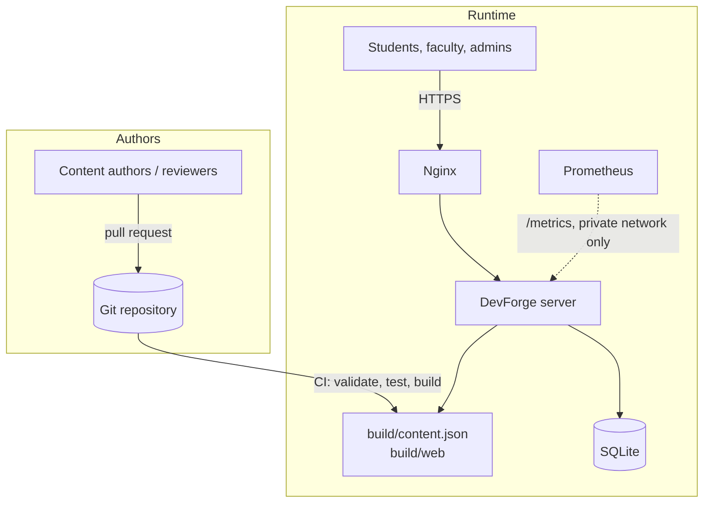
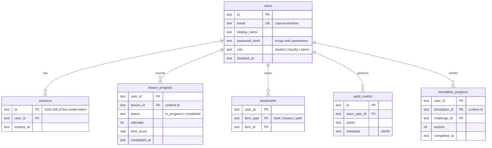

# Architecture

This document explains how DevForge 18 works and why it is shaped this way. Decisions are recorded individually in [`adr/`](adr/).

## System context

There are two flows. **Content** flows from authored files through validation into an immutable bundle. **Learner state** (accounts, sessions, progress, bookmarks, audit events) flows through the API into the database. Keeping them apart means content can be reviewed like code, and the database holds only what genuinely changes at runtime.

## Content pipeline

1. Authors edit `content/tracks/*/track.yaml`, `content/paths/*.yaml` and `content/lessons/<track>/*.md`.
2. `npm run content:build` (`scripts/build-content.ts`) parses YAML with `safeLoad`, validates every file against the zod schemas in `shared/content-schema.ts`, runs cross-reference checks, renders lesson Markdown to HTML, and writes `build/content.json`.
3. On start-up the server loads the bundle into `ContentStore` (`server/src/content/store.ts`), which indexes it and builds the search index.

Lesson Markdown rendering (`scripts/lib/markdown.ts`) escapes raw HTML, allows only `https:`, `http:`, `mailto:`, relative and `#` links, and highlights code with highlight.js. Because rendering happens at build time, browsers receive finished HTML and no Markdown parser.

## Request lifecycle

For an API request (`server/src/app.ts`):

1. Assign a request ID; apply security headers (CSP, `nosniff`, frame denial, referrer policy).
2. Resolve the client IP (right-most `X-Forwarded-For` entry only when `TRUST_PROXY=true`).
3. Apply the coarse per-IP API limit.
4. Match the route; params must be safe identifiers, so traversal sequences never reach handlers.
5. For `POST`/`PUT`/`PATCH`/`DELETE`: enforce CSRF (custom header, `Origin`, `Sec-Fetch-Site`).
6. Resolve the session cookie to a user (hashed lookup, expiry, disabled check).
7. Enforce the route's `auth` option (`"user"` or a list of roles).
8. Run the handler; bodies are read with a 64 KB limit and validated with zod.
9. Map errors to a consistent shape: `{ "error": { "code", "message", "details?", "requestId" } }`. Unexpected errors are logged with the request ID and returned as a generic 500.
10. On finish: record Prometheus metrics labelled by **route pattern** (never raw URLs) and write one JSON access-log line.

Non-API paths are served from `build/web`: hashed assets are cached as immutable; every extension-less path returns `index.html` so the single-page app can route it.

## Data model

Tables are `STRICT`, use foreign keys with `ON DELETE CASCADE` where the child has no meaning without the parent, and are created by numbered migrations in `server/src/db/migrations/`. Applied migrations are checksummed: editing one after it has run stops the server with a clear error, so the schema history cannot silently diverge between environments.

The blueprint's content entities (tracks, lessons, quizzes, resources…) are deliberately **not** tables: see [ADR 0003](adr/0003-content-as-code.md). Tables for labs, submissions, cohorts and certificates will be added by new migrations in the phases that need them.

## Simulations

Simulations (REMAINING_WORK.md §4.3, [ADR 0008](adr/0008-simulations-verified-by-replay.md)) are pure, deterministic models in `shared/simulations/` that run in the browser and on the server. The browser loads a simulation's model and view as a separate JavaScript chunk only when one is on screen (esbuild code splitting), so the main bundle does not grow with each simulation. When a learner solves a challenge, the page sends the list of actions they took; the server validates each one with the model's schema, replays them through the same model, runs the challenge's check and only then records it in `simulation_progress`.

## Learning progress rules

- Opening a lesson while signed in records `in_progress` (used for "continue learning").
- A lesson becomes `completed` only when its self-check is submitted with every answer correct. Grading happens on the server; answers and explanations are never sent to the browser beforehand.
- Explanations are returned only for correctly answered questions, so a failed attempt does not reveal the answers.
- A later failed attempt never un-completes a lesson; `best_score` keeps the best result.
- A simulation challenge is recorded only after the server has replayed the learner's actions and the check passed; it is saved once per learner and challenge.

## Frontend

- React 19 single-page app (`web/src`) bundled by esbuild (`scripts/build-web.ts`).
- A small history-API router (`web/src/lib/router.tsx`) and a fetch wrapper that adds the CSRF header to every write (`web/src/lib/api.ts`).
- Public content responses are cached in memory per session; personal data is always fetched fresh.
- After each navigation, focus moves to `<main>` and the document title updates, so screen-reader users hear the new page.
- The theme is applied before first paint by `/theme-init.js` (an external file, because the CSP forbids inline scripts).

## Observability

- **Logs**: one JSON object per line (`ts`, `level`, `msg`, `requestId`, `route`, `status`, `ms`). Keys that look sensitive are redacted.
- **Metrics** at `/metrics` (Prometheus text format): `devforge_http_requests_total{method,route,status}`, `devforge_http_request_duration_seconds` histogram, resident memory and uptime. Served only to private-network addresses; the bundled Nginx also blocks it publicly.
- **Health**: `/api/health` (liveness) and `/api/ready` (database reachable, content loaded).
- OpenTelemetry tracing is planned for Phase 6, when the platform has more than one service to trace across.

## How the platform uses its own curriculum

The blueprint asks the team to explain the platform's own technology choices. DevForge uses the tools it teaches only where they solve a real problem here:

| Track | Used by DevForge? | Why / why not |
|---|---|---|
| Git + GitHub, GitHub Actions | Yes | Source of truth for code *and* content; CI on every change |
| Docker, Nginx | Yes (deployment) | Reproducible image; TLS, compression and edge limits in front of the app |
| Prometheus | Yes (endpoint) | `/metrics` ready to scrape; dashboards come with deployment |
| PostgreSQL | Not yet | SQLite is enough at college scale and needs no installation ([ADR 0002](adr/0002-database.md)) |
| Redis | Not yet | Needed only when running several instances that must share rate limits or sessions |
| OpenTelemetry | Planned | Valuable once there are multiple services |
| Kafka, Airflow, n8n, MLflow, Kubernetes, Terraform, Jenkins, LangChain/LlamaIndex | No | No genuine need in the core platform; the blueprint warns against adding them "merely to demonstrate that they are present" |

Explaining *why not* is itself engineering judgement — the skill the platform exists to teach.
